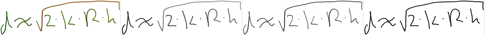
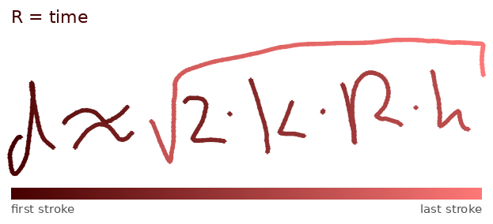
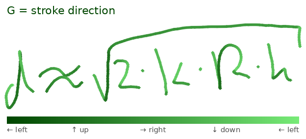
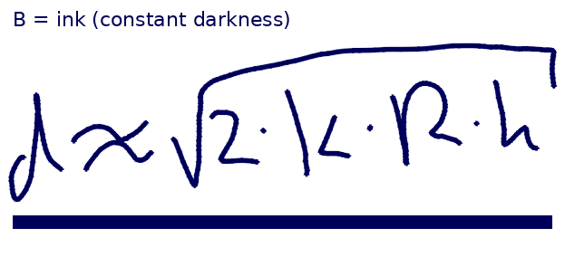

# handwritten-math-latex

Recognise handwritten mathematical formulas and convert them to LaTeX. The work is aimed at the open-source, non-commercial [xnotes](https://github.com/shardulvs/xnotes-android) Android notes app. Training is in Python (PyTorch); on-device inference is planned through ONNX Runtime in C++ or Rust. The app itself stays MIT-licensed: the model is a separate download.

The recogniser is a fine-tune of [Texo](https://github.com/alephpi/Texo) / [FormulaNet](https://huggingface.co/alephpi/FormulaNet) (20M parameters: HGNetv2 CNN encoder + 2-layer MBart decoder, 384×384 input, 687-token KaTeX vocabulary) on the [MathWriting](https://arxiv.org/abs/2404.10690) handwritten-formula dataset.

**Weights are not stored in this repository.** They will be published separately on Hugging Face. Because they are fine-tuned from Texo (AGPL-3.0) on MathWriting (CC BY-NC-SA 4.0), the weights are for non-commercial use only. See [Licence](#licence).

## Current metrics (v5, shipped default)

Official [MathWriting](https://arxiv.org/abs/2404.10690) **test set, 7,644 formulas**, beam 4, `length_penalty=0.0`, scored with `hw/normalize.py`. One 20M-parameter model reads stroke input and plain images (photos/scans). Ship size: **40 MB** ONNX fp16, or **35 MB** fp16 encoder + int8 decoder.

| model | input | exact | CER | TER | size | params |
|---|---|---|---|---|---|---|
| **ours v5** | strokes (colour) | **63.91%** | **6.95%** | **5.16%** | 40 MB / 35 MB | 20M |
| **ours v5** | grey ink | 63.80% | 6.92% | 5.18% | 40 MB / 35 MB | 20M |
| **ours v5** | plain images | 63.72% | 6.96% | 5.21% | 40 MB / 35 MB | 20M |
| ink2latex r3 | strokes | 59.2% | 8.28% | 6.18% | 19–35 MB | 9.8M |
| TexTeller 3 | images | 74.5%† | 7.25% | 4.75% | 318 MB | ~300M |

† TexTeller 3 was scored on a fixed 1,000-sample subset, not the full 7,644 (too slow on our CPU). Its handwritten training mix includes existing open-source test sets, so this score is likely inflated; we did not independently measure overlap with the MathWriting test. ink2latex figures are our re-score of r3 beam 5 on the same full 7,644 labels. Details: `results/competitors/RESULTS.md` and `results/kaggle_v5/compare/SUMMARY.md`.

## The key idea: stroke order as colour

A pen app records *how* a formula was written, not just the final ink. We put that into the image itself: each stroke is drawn with **red = time** (normalised arc length, so early strokes are dark and late strokes are bright), **green = stroke direction**, and **blue = ink**. Texo's encoder already takes RGB input, so the model architecture is unchanged; only the rendering changes. The app renders its recorded strokes the same way before inference.



Each channel on its own, tinted in its colour (same shading as the model input: dark = low value, bright = high value):



Red shows writing order: `d ≈` was written first, then `2·k·R·h`, and the root sign with its bar was drawn last, around the content that was already there.



Green shows the direction the pen was moving at each point (left, up, right, down, back to left), so a `2` and a `z`, or strokes that look the same but were drawn differently, get different shades.



Blue is just the ink, the same for every stroke, so the image still reads as a normal drawing of the formula.

Generated with `scripts/render_channel_explainers.py`.

On the same test inks this gave about **+1 exact-match point** over greyscale (v3 → v4). Training on a mix of colour strokes, grey strokes and plain raster images (v5) keeps one model robust for photos and scans as well.

## Results

All figures below are on the official MathWriting **test set, all 7,644 human inks**, with our canonical label normalisation (`hw/normalize.py`) used both for training targets and for scoring.

| model | decoding | CER | token error rate | exact match |
|---|---|---|---|---|
| Texo zero-shot | greedy | 38.4% | 28.9% | 10.9% |
| v1 (5k-image subset, 5 epochs) | greedy | 17.8% | 13.5% | 32.5% |
| v2 best (full human train, epoch 2) | greedy | 9.03% | 6.91% | 56.9% |
| v2 best | beam 4, length_penalty=1.0 (HF default) | 8.73% | 6.66% | 57.7% |
| v2 best | beam 4, length_penalty=0.0 | 8.60% | 6.58% | 57.8% |
| v3 best (human + synthetic + stroke aug, epoch 4) | greedy | 7.79% | 5.84% | 61.8% |
| v3 best | beam 4, length_penalty=1.0 | 7.43% | 5.56% | **62.6%** |
| v3 best | beam 4, length_penalty=0.0 (default) | 7.39% | 5.49% | 62.5% |
| v4 best (colour InkML strokes, 3 epochs, still improving) | greedy | 7.26% | 5.41% | 63.3% |
| v4 best | beam 4, colour InkML | 6.98% | 5.15% | 64.0% |
| v5 best (shipped default; mixed colour/grey/photo, 4 epochs, still improving) | beam 4, colour InkML | 6.95% | 5.16% | 63.9% |
| v5 best | beam 4, greyscale InkML | **6.92%** | 5.18% | 63.8% |
| v5 best | beam 4, deepcopy photos | 6.96% | 5.21% | 63.7% |

v2 was trained on all 229,864 official human training inks (Kaggle, 2× Tesla T4). The run hit a host-RAM out-of-memory error in epoch 3; the best checkpoint is epoch 2 (valid CER 6.51% on a 2,000-sample valid subset). That OOM is fixed in the current dataloader (one contiguous image buffer, at most two short-lived eval workers).

Beam search with `length_penalty=0.0` (raw log-prob sum, now the default in `hw.model.predict`) beat HuggingFace's default of 1.0 by 10 extra exact formulas on the official test set (4,419 / 7,644 vs 4,409). The length penalty had been rewarding over-structuring (`Hz` → `H_{z}`, `Mg` → `M_{g}`). Brace/grammar-constrained decoding did not change any v2 beam-4 output. Checkpoint averaging was not possible: only v2-best was saved. Details: `results/decode_v2/SUMMARY.md`.

v3 continues from v2-best and mixes the official MathWriting **synthetic** inks 1:1 with the human training inks (each epoch: all 229,864 human samples plus 229,864 fresh draws from the 396,013 synthetic inks). Human samples use the pre-rendered image half the time and otherwise a re-render from InkML with **stroke-level augmentation** (small rotation, shear, scale, per-stroke offset, point jitter, smoothing, variable pen width, grey ink); synthetic samples are always rendered with augmentation. It trained for 6 epochs on one Kaggle Tesla T4 (8.0 h of training, 8.3 h kernel time); best valid CER was epoch 4 (5.29% on the 2,000-sample valid subset; epoch 5: 5.33%). Compared with v2, beam-4 exact match rose from 57.8% to 62.5% (+4.7 points), CER from 8.60% to 7.39%, TER from 6.58% to 5.49%.

On v3, `length_penalty` 0.0 and 1.0 are a tie on exact match (4,781 vs 4,782 of 7,644); 0.0 is slightly better on CER and TER, so it stays the default. Averaging the best (epoch 4) and last (epoch 5) checkpoints gave no gain. Details: `results/decode_v3/SUMMARY.md`.

v4 continues from v3-best and encodes **stroke time, direction and ink** in the three RGB channels of InkML renders (R = normalised arc-length time along the ink, G = stroke direction, B = ink darkness). Texo's HGNetv2 stem is already 3-channel, so the first convolution is not widened; `preprocess` keeps RGB instead of flattening to greyscale. Human training images are always re-rendered from strokes (same 1:1 synthetic mix and stroke augmentation as v3; `human_image_prob=0`). Official valid and test images are also rendered from InkML (deterministic). It trained for 3 of 10 planned epochs on one Kaggle Tesla T4 (5.25 h of training, ~7 h kernel time, 7 h cap) and was still improving; best valid subset exact match was epoch 2 (75.1% on 2,000 samples; full valid greedy 73.13%, n=15,674). Example colour / greyscale / per-channel images: `results/v4_stroke_colour_samples/`.

On colour InkML, beam-4 exact match is 4,891 / 7,644 (63.98%), CER 6.98%, TER 5.15%. That meets the ink2latex 10% relative target (≥63.3% exact, TER ≤ 5.56%) on this protocol. A fair comparison against v3 on the **same greyscale InkML renders** (not the published deepcopy photos) is: v3 62.95% exact (4,812) / CER 7.25% / TER 5.44%, vs v4 colour **+1.03 exact points**. v4 is also robust to our own greyscale InkML (63.51%, 4,855). It is **not** robust to official pre-rendered deepcopy images (photos/scans): exact match falls to 25.30% (1,934), CER 46.44%. Do not use v4-best on photos. Details: `results/kaggle_v4/compare/SUMMARY.md`.

v5 continues from v4-best and mixes colour InkML, greyscale InkML (`--color-mix 0.70`) and official raster images (`--human-image-prob 0.40`) so **one model** reads both strokes and photos/scans (about 56% colour ink, 24% grey ink, 20% official images in a 1:1 human/synthetic epoch). It trained for 4 of 10 planned epochs on one Kaggle Tesla T4 (5.69 h of training, 7.01 h cap, 95.4 min/epoch) and was still improving; best valid subset exact match was epoch 3 (76.0% on 2,000 samples; full valid greedy 73.98%, n=15,674). Kernel: `kaggle/v5_kernel` (`windwerfer/handwriter-texo-v5-mixed-colour-grey` version 1).

On the official test set with beam 4, v5 scores 63.91% exact (4,885 / 7,644) / CER 6.95% / TER 5.16% on colour InkML (a near-tie with v4: −6 exact, slightly better CER), 63.80% (4,877) / 6.92% / 5.18% on greyscale InkML (best so far, +0.29 vs v4), and 63.72% (4,871) / 6.96% / 5.21% on deepcopy photos (recovers from v4's 25.30% and beats v3 by +1.17 points). Greedy is about 0.3–0.5 points lower. All three v5 protocols meet the ink2latex target (≥63.3% exact, TER ≤ 5.56%). **v5 is the shipped default.** The next Kaggle run, after the weekly GPU reset on Saturday 28 Nov 2026 at 01:00 Europe/Berlin, should continue from v5-best for more epochs. Details: `results/kaggle_v5/compare/SUMMARY.md`.

Typical remaining errors: letter case (`x`/`X`, `p`/`P`, …), `.` versus `\cdot`, look-alike symbols (`\omega`/`w`, `\nu`/`v`, `d`/`\partial`), and brace or subscript structure.

Predictions, metrics and sample images: `results/kaggle_v2_eval/` (length_penalty=1.0), `results/decode_v2/` (decode tuning, including length_penalty=0.0), `results/kaggle_v3/` (v3 training log, per-epoch valid predictions, test predictions, ONNX parity), `results/decode_v3/`, `results/kaggle_v4/` (v4 training log, test predictions, fairness/robustness comparison, ONNX parity), and `results/kaggle_v5/` (v5 mixed-training log, colour / grey-ink / deepcopy test predictions, ONNX parity).

For reference, a much larger TrOCR model trained on MathWriting (`tjoab/latex_finetuned`, 334M) reports 14.9% CER, under a different normalisation, so the number is not strictly comparable.

### ONNX export (v3 best)

Exported with `scripts/export_onnx.py` inside the Kaggle v3 kernel. The ONNX files themselves are not in git (`*.onnx` is gitignored). Parity was measured on **200 random official-test samples** with greedy decoding on the Kaggle CPU (ONNX Runtime, slower than a desktop CPU, so compare the s/img column only within the table). The CER column here is not the full-test figure above.

| variant | encoder + decoder size | CER | exact match | identical to PyTorch | s/img |
|---|---|---|---|---|---|
| PyTorch fp32 | – | 7.56% | 59.5% | – | 0.219 |
| ONNX fp32 | 57.3 + 22.7 = 80.0 MB | 7.56% | 59.5% | 100% | 0.173 |
| ONNX fp16 | 28.7 + 11.4 = 40.1 MB | 7.56% | 59.5% | 100% | 0.184 |
| ONNX int8 (dynamic, both) | 14.6 + 5.8 = 20.5 MB | 8.14% | 60.0% | 86.5% | 0.917 |
| encoder fp32 + decoder int8 | 63.2 MB | 7.43% | 59.0% | 97% | 0.165 |
| **encoder fp16 + decoder int8** | **34.5 MB** | 7.61% | 59.5% | 98.5% | 0.163 |

As with v2, fp16 is the safe default (about 40 MB, identical to PyTorch on this sample) and the fp16 encoder + int8 decoder is the smaller option (about 35 MB, 98.5% identical). Full int8 is smaller but slower and less faithful on CPU. The graphs are `encoder.onnx` (`pixel_values` f32\[B,3,384,384\] → f32\[B,144,384\]) and `decoder.onnx` (no KV cache). Decoding is a greedy loop plus `tokenizer.json`, then `hw.latex_tok.from_texo`.

v2-best export, for reference (200 test samples, box CPU): ONNX fp16 40.2 MB, 8.74% CER, 58.5% exact; encoder fp16 + decoder int8 34.6 MB, 8.56% CER, 58.5% exact.

### ONNX export (v4 best)

Exported with `scripts/export_onnx.py` on the box, on **200 random official-test colour InkML renders** (seed 0, greedy). The ONNX files themselves are not in git (`*.onnx` is gitignored). The CER column here is the 200-sample figure, not the full-test 7.26% greedy above. Details: `results/kaggle_v4/onnx_parity.json`.

| variant | encoder + decoder size | CER | exact match | identical to PyTorch | s/img |
|---|---|---|---|---|---|
| PyTorch fp32 | – | 8.72% | 63.5% | – | 0.066 |
| ONNX fp32 | 57.3 + 22.7 = 80.0 MB | 8.72% | 63.5% | 100% | 0.044 |
| ONNX fp16 | 28.7 + 11.4 = 40.2 MB | 8.72% | 63.5% | 100% | 0.047 |
| ONNX int8 (dynamic, both) | 14.6 + 5.9 = 20.5 MB | 8.78% | 64.5% | 90% | 0.244 |
| encoder fp32 + decoder int8 | 63.2 MB | 8.72% | 63.5% | 97% | 0.035 |
| **encoder fp16 + decoder int8** | **34.6 MB** | 8.21% | 63.5% | 97.5% | 0.034 |

Same recommendation as v3: fp16 is the safe default (about 40 MB, identical to PyTorch on this sample) and the fp16 encoder + int8 decoder is the smaller option (about 35 MB, 97.5% identical).

### ONNX export (v5 best)

Exported with `scripts/export_onnx.py` on the box. Parity is measured on **200 random official-test samples** (seed 0, greedy) for both colour InkML and deepcopy photos. The ONNX files themselves are not in git (`*.onnx` is gitignored). The CER columns are 200-sample figures, not the full-test numbers above. Details: `results/kaggle_v5/onnx_parity.json`.

Colour InkML:

| variant | encoder + decoder size | CER | exact match | identical to PyTorch | s/img |
|---|---|---|---|---|---|
| PyTorch fp32 | – | 9.00% | 62.0% | – | 0.123 |
| ONNX fp32 | 57.3 + 22.7 = 80.0 MB | 9.00% | 62.0% | 100% | 0.077 |
| ONNX fp16 | 28.7 + 11.4 = 40.2 MB | 9.00% | 62.0% | 100% | 0.077 |
| ONNX int8 (dynamic, both) | 14.6 + 5.9 = 20.5 MB | 8.78% | 63.0% | 88.0% | 0.354 |
| encoder fp32 + decoder int8 | 63.2 MB | 8.46% | 62.5% | 95.5% | 0.057 |
| **encoder fp16 + decoder int8** | **34.6 MB** | 8.15% | 63.0% | 95.5% | 0.055 |

Deepcopy photos:

| variant | encoder + decoder size | CER | exact match | identical to PyTorch | s/img |
|---|---|---|---|---|---|
| PyTorch fp32 | – | 7.14% | 60.0% | – | 0.104 |
| ONNX fp32 | 57.3 + 22.7 = 80.0 MB | 7.14% | 60.0% | 100% | 0.073 |
| ONNX fp16 | 28.7 + 11.4 = 40.2 MB | 7.14% | 60.0% | 100% | 0.076 |
| ONNX int8 (dynamic, both) | 14.6 + 5.9 = 20.5 MB | 7.12% | 59.0% | 88.5% | 0.375 |
| encoder fp32 + decoder int8 | 63.2 MB | 6.97% | 59.5% | 97.5% | 0.060 |
| **encoder fp16 + decoder int8** | **34.6 MB** | 7.01% | 59.5% | 97.0% | 0.058 |

fp16 is the safe default (about 40 MB, identical to PyTorch on both samples). The fp16 encoder + int8 decoder is the smaller option (about 35 MB; 95.5% identical on colour, 97.0% on photos). Full int8 is smaller but slower and less faithful on CPU. These CER columns are 200-sample figures, not the full-test numbers above. **v5 remains the shipped default**; ONNX parity is not an issue.

## Status: v5 is the shipped default

v5 is the current default model for both stroke input and photos/scans. Weekly Kaggle GPU quota is exhausted until Saturday 28 Nov 2026, 01:00 Europe/Berlin. The next run should continue from v5-best for more epochs (valid was still improving at epoch 3). After that, the roadmap is distillation from TexTeller 3 and hard-case oversampling.

## Licence

This repository uses more than one licence. Please read this section before you reuse the code or train a model.

- **Original code** in this repository (the training and evaluation pipeline, label normalisation, ink packing and augmentation, ONNX export, Kaggle kernel scripts, and tests) is licensed under the **MIT License**, Copyright © 2026 Thomas Barth. See [`LICENSE`](LICENSE).
- **`hw/texo_vendor/`** is vendored from [Texo](https://github.com/alephpi/Texo) and remains **GNU Affero General Public License v3.0**. The full text is in [`hw/texo_vendor/LICENSE-AGPL-3.0`](hw/texo_vendor/LICENSE-AGPL-3.0). Those files also carry earlier copyright notices (D-FINE, RT-DETR / PaddleDetection, and others) from upstream. Loading FormulaNet/Texo in this project imports that encoder (`hw/model.py`), so if you distribute a program that includes `hw/texo_vendor/`, AGPL obligations apply to that combined work. Files that do not include the vendored encoder can be used under MIT on their own.
- **Fine-tuned weights** are **not MIT**. They start from Texo/FormulaNet (AGPL-3.0) and are trained on MathWriting (**[CC BY-NC-SA 4.0](https://creativecommons.org/licenses/by-nc-sa/4.0/)**, non-commercial, share-alike). They will be distributed separately, with those restrictions stated on the model card.

This project itself is intended to stay open source and non-commercial.

## Setup

Python 3.11 or newer:

```bash
uv venv -p 3.11 .venv && . .venv/bin/activate
uv pip install torch==2.7.0 torchvision --index-url https://download.pytorch.org/whl/cpu
uv pip install -r requirements.txt
```

On a GPU machine, install a CUDA build of PyTorch instead of the CPU index above.

**Data.** Download the official MathWriting release (human and synthetic inks) and/or the pre-rendered image mirror [`deepcopy/MathWriting-human`](https://huggingface.co/datasets/deepcopy/MathWriting-human) (parquet: images + normalised LaTeX). Put local data under `data/` (gitignored). Official inks are distributed as `mathwriting-2024.tgz` from the [MathWriting](https://arxiv.org/abs/2404.10690) project.

**Base model.** Download [alephpi/FormulaNet](https://huggingface.co/alephpi/FormulaNet) into `models/texo/` (`config.json`, tokenizer files, `model.safetensors`). Weight files are gitignored.

Optional subset for a quick run:

```bash
python scripts/prep_data.py --train 5000 --valid 500 --test 500
```

Pack official InkML strokes (needed for stroke augmentation and for mixing human and synthetic data):

```bash
python scripts/prep_inks.py --tgz path/to/mathwriting-2024.tgz --out data/inks
```

## Training

CPU smoke test (no checkpoint written):

```bash
python scripts/train.py --out runs/smoke --train-limit 48 --valid-limit 8 --test-limit 20 \
  --epochs 1 --max-steps 12 --batch-size 4 --eval-batch-size 4 --warmup 2 --lr 2e-5 --workers 0 --no-save
```

Full training is done on Kaggle (Tesla T4 GPUs). Kernel definitions live in `kaggle/kernel` (v2), `kaggle/eval_kernel` (v2 full-test eval), `kaggle/v3_kernel` (v3), `kaggle/v4_kernel` (v4 stroke-colour), and `kaggle/v5_kernel` (v5 mixed colour/grey + raster images). Those datasets and kernels are private. To run your own copy, point the `kaggle/*-metadata.json` files at your account, upload a dataset of code and data, and push the kernel with `kaggle kernels push -p kaggle/v5_kernel`.

Useful `scripts/train.py` flags: `--time-budget-h`, `--beams 1 4`, `--final-full-valid`, `--ink-dir` and `--synth-ratio` for human+synthetic mixing, `--color-strokes` to encode stroke time/direction as RGB and render valid/test from InkML, `--color-mix` (fraction of ink renders that stay in colour; the rest are greyscale InkML), `--human-image-prob` (fraction of human samples that use official raster images), `--eval-plain-images` (final greyscale InkML + deepcopy evals), and `--data-parallel`. BatchNorm running statistics stay frozen during fine-tuning unless you pass `--bn-train` (small batches can wreck them).

The training loop computes the cross-entropy loss itself, so it is not tied to one `transformers` version (VisionEncoderDecoder label shifting differs across releases).

## Evaluation

```bash
python scripts/eval.py --test data/raw/test-*.parquet --out runs/eval \
    --model zeroshot=models/texo:1 --model v2=path/to/v2best:1,4

# Official-test InkML renders (greyscale or colour):
python scripts/eval.py --test data/raw/test-*.parquet --ink-dir data/inks --ink-split test \
    --color-strokes --out runs/eval-colour --model v4=path/to/v4best:4
```

Each `--model` is `NAME=PATH:BEAMS`. The script writes `metrics.json`, `predictions_*.csv`, and comparison sample PNGs. Metrics are character error rate (whitespace-insensitive), token error rate, and exact match, all after canonical normalisation. Beam search uses `--length-penalty 0.0` by default (recommended; see `results/decode_v2/`).

To compare length penalties, grammar-constrained decoding, or averaged checkpoints:

```bash
python scripts/eval_decode.py --model path/to/best \
    --valid 'data/raw/val-*.parquet' --test 'data/raw/test-*.parquet' \
    --out results/decode_v2 --valid-limit 1000 --seed 0 \
    --length-penalties 0.0 0.6 0.8 1.0 --brace both
python scripts/average_checkpoints.py --out models/swa --discover runs/v3
```

## Export ONNX

```bash
python scripts/export_onnx.py --model path/to/v2best --out onnx/v2best \
    --test data/raw/test-00000-of-00001.parquet --n 200
```

This exports fp32, fp16, int8, and mixed encoder/decoder variants, and checks greedy-decoding parity against PyTorch.

## Label normalisation

Normalisation lives in **our code**, `hw/normalize.py`, not in the dataset files. The same canonical form is used as the training target and for scoring, so zero-shot Texo is not punished only for writing `\lim` when the MathWriting label is `lim`. The official dataset labels on disk are left unchanged.

Examples: `lim` becomes `\lim`, `\infin` becomes `\infty`, `\left` and `\quad` are dropped, sub- and superscripts are braced, and `\ldots` becomes `...`. The function is idempotent; see `tests/test_normalize.py`. About 7% of MathWriting labels change in a non-whitespace way. Texo vocabulary gaps are mapped in `hw/latex_tok.py` (`\infty` ↔ `\infin`, and so on): 0 out-of-vocabulary tokens and 0 round-trip mismatches on train shard 0 + valid + test.

## Layout

- `hw/` — model loading, data, metrics, label normalisation, ink packing and augmentation
- `hw/texo_vendor/` — HGNetv2 encoder vendored from Texo (AGPL-3.0)
- `scripts/prep_data.py`, `prep_inks.py`, `train.py`, `eval.py`, `eval_decode.py`, `average_checkpoints.py`, `export_onnx.py`, `render_stroke_colour_samples.py`
- `kaggle/` — private Kaggle dataset and kernel definitions
- `results/` — published metrics, predictions and sample images (no weights)
- `tests/` — `pytest` (78 tests at the time of this writing)

## Credits

- [Texo](https://github.com/alephpi/Texo) / [FormulaNet](https://huggingface.co/alephpi/FormulaNet) by [alephpi](https://github.com/alephpi), AGPL-3.0. Technical report: [arXiv:2602.17189](https://arxiv.org/abs/2602.17189).
- MathWriting: Philippe Gervais, Anastasiia Fadeeva, and Andrii Maksai, *MathWriting: A Dataset For Handwritten Mathematical Expression Recognition*, [arXiv:2404.10690](https://arxiv.org/abs/2404.10690), 2024. Licensed [CC BY-NC-SA 4.0](https://creativecommons.org/licenses/by-nc-sa/4.0/).

```bibtex
@misc{gervais2024mathwriting,
  title={MathWriting: A Dataset For Handwritten Mathematical Expression Recognition},
  author={Philippe Gervais and Anastasiia Fadeeva and Andrii Maksai},
  eprint={2404.10690},
  archivePrefix={arXiv},
  year={2024}
}
```
